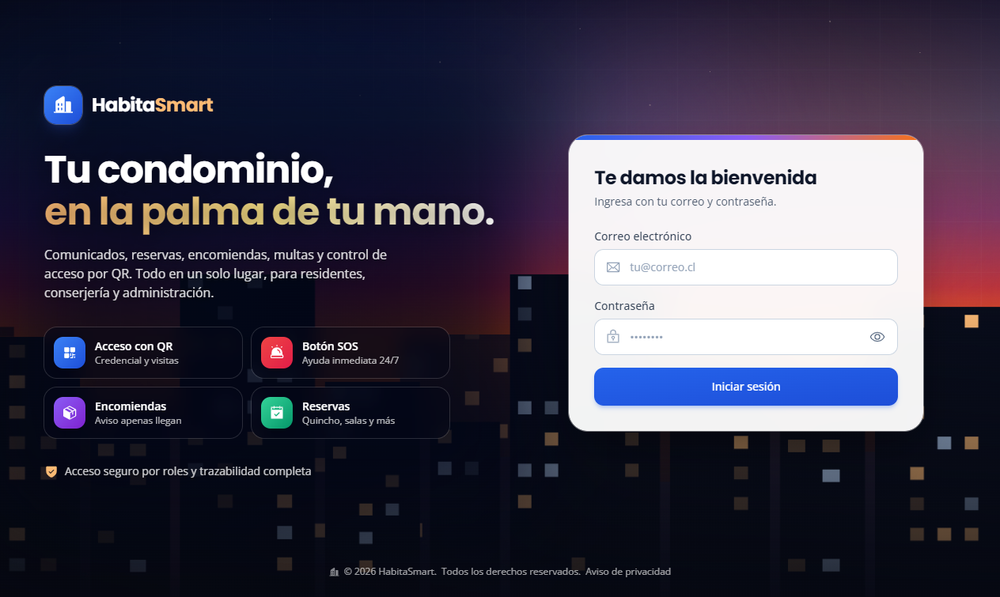

<div align="center">

# HabitaSmart

### Plataforma integral para la gestión de condominios

Control de acceso por QR, encomiendas, reservas de espacios comunes, gastos comunes, comunicados, multas y alertas SOS — todo en un solo lugar, para **residentes**, **conserjería** y **administración**.

**🌐 Demo en vivo: [habitasmart.onrender.com](https://habitasmart.onrender.com)**



</div>

---

## ¿Qué es HabitaSmart?

HabitaSmart es una plataforma web — también disponible como **aplicación de escritorio** y como **app instalable en el teléfono** — que digitaliza la operación diaria de un condominio. Reemplaza los cuadernos de conserjería, los grupos de WhatsApp y las planillas sueltas por un sistema único, trazable y seguro, pensado para la realidad de los condominios en Chile.

El objetivo es que cada actor tenga exactamente lo que necesita:

- **Residentes** entran y salen con un QR, reciben avisos de sus encomiendas, reservan el quincho, pagan sus gastos comunes y se enteran de todo desde el celular.
- **Conserjería** valida accesos, registra encomiendas y mantiene el control del edificio sin papeleo.
- **Administración** gestiona usuarios, cobra los gastos comunes, publica comunicados, cursa multas y tiene visibilidad completa de lo que ocurre.

---

## Funcionalidades

### 🔐 Control de acceso
- **Credencial digital con QR** para cada residente, que **rota cada ~60 segundos** por seguridad (si alguien le saca una foto, deja de servir casi de inmediato).
- **Código corto de respaldo** para validación manual en portería cuando no se puede escanear.
- **Invitaciones a visitas** con QR de un solo uso o por un período acotado.
- **Validación en conserjería** por cámara o a mano, con el resultado (autorizado / rechazado) y el detalle del acceso en pantalla.
- **Registro de todos los accesos** con fecha, hora y motivo.

### 📦 Encomiendas
- La conserjería registra la encomienda y el residente recibe el aviso al instante.
- **Foto de la etiqueta desde la propia app** (cámara) con **lectura automática (OCR)** que completa número de seguimiento, empresa y destinatario.
- El residente ve el estado de sus encomiendas y la confirmación de retiro.

### 📅 Reservas de espacios comunes
- Quincho, salas y otros espacios con **calendario de disponibilidad** y selección de horarios por bloques.
- El residente ve en el momento qué horas están ocupadas.

### 💰 Gastos comunes
- Cobro mensual por unidad, registro de pagos y control de morosidad.
- El residente consulta su detalle y su estado de cuenta.

### 📢 Comunicados y documentos
- Publicación de comunicados del condominio con notificación.
- Repositorio de documentos (reglamentos, actas, circulares).

### ⚠️ Seguridad y convivencia
- **Botón SOS** con alerta inmediata (incluso con notificación del sistema, aunque la app esté cerrada).
- **Incidencias**: los residentes reportan problemas y la administración les da seguimiento.
- **Multas**: cursado y seguimiento de infracciones.

### 🛠️ Administración y trazabilidad
- Gestión de usuarios, torres y unidades.
- **Auditoría** completa de las acciones relevantes del sistema.
- Panel con el resumen del condominio.

---

## Multiplataforma

HabitaSmart funciona en tres formatos, sobre un mismo backend y los mismos datos:

| Formato | Para quién | Cómo |
|---|---|---|
| **Web responsiva** | Todos | Desde cualquier navegador: computador, tablet o celular |
| **App de teléfono (PWA)** | Residentes | "Agregar a la pantalla de inicio" en iPhone/Android, con notificaciones |
| **App de escritorio (.exe)** | Conserjería y administración | Instalable en Windows; abre la plataforma como un programa, sin navegador (ver [`desktop/`](desktop/)) |

---

## Tecnología

**Frontend:** React 18 · TypeScript · Vite · TailwindCSS · PWA (service worker + Web Push)
**Backend:** Node.js · Express · TypeScript · Prisma ORM
**Base de datos:** PostgreSQL
**Escritorio:** Electron + electron-builder
**Calidad:** Vitest (batería de pruebas automatizadas) · ESLint
**Infraestructura:** Render (servicio web) · Supabase (base de datos) · GitHub Actions (tareas programadas)

---

## Estructura del repositorio

```
Proyecto de Titulo/
├── frontend/     Aplicación web (React + Vite)
├── backend/      API REST (Express + Prisma)
├── desktop/      Aplicación de escritorio (Electron)
├── docs/         Documentación y recursos
└── README.md
```

## Puesta en marcha (desarrollo)

Requisitos: Node.js 18+ y una base de datos PostgreSQL.

```bash
# Instalar dependencias (workspaces de frontend y backend)
npm install

# Configurar variables de entorno
# backend/.env  -> DATABASE_URL, JWT_SECRET, claves VAPID, etc.

# Preparar la base de datos
npm run prisma:migrate
npm run prisma:seed

# Levantar en desarrollo
npm run dev:backend
npm run dev:frontend
```

La app de escritorio se prueba y empaqueta desde [`desktop/`](desktop/) (ver su propio README).

## Despliegue

La plataforma se despliega de forma continua: cada cambio integrado a `main` publica automáticamente la nueva versión (incluidas las migraciones de base de datos). La web se mantiene siempre actualizada y las apps de escritorio y de teléfono, al cargar el servicio en vivo, reflejan esos cambios sin necesidad de reinstalarse.

---

## Estado del proyecto

HabitaSmart es un **producto funcional y en operación**, no un prototipo: está desplegado, probado en dispositivos reales y preparado para implementarse en un condominio. El desarrollo continúa con foco en robustez, operación y la incorporación de mejoras pensadas junto a quienes administran y habitan un condominio.

## Equipo

Proyecto desarrollado por **Felipe Valdez**, **Gabriel Salvo** y **Carlos Toro**.

## Licencia

© 2026 HabitaSmart. Todos los derechos reservados. Este software es propietario; no se autoriza su uso, copia, distribución ni modificación sin permiso expreso de sus autores.
